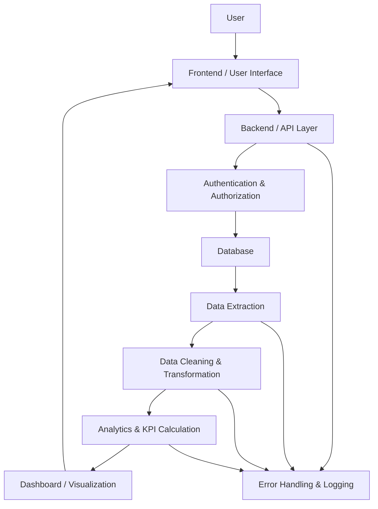

# Software Architecture Diagram
## Data Analytics Dashboard System

### 1. Introduction
This architecture explains how a Data Analytics Dashboard works, from user interaction and data collection to data processing, database storage and final visualization.

### 2. Architecture Diagram

### 3. Components Explanation

**1. User**
- Interacts with the dashboard.
- Selects filters and requests reports.
- Views analytical results.

**2. Frontend / User Interface**
- Provides the dashboard interface.
- Displays charts, graphs, tables and KPI cards.
- Sends user requests to the backend.

**3. Backend / API Layer**
- Receives requests from the frontend.
- Processes business logic.
- Communicates with the database.

**4. Authentication & Authorization**
- Verifies user identity.
- Controls access to dashboard features and data.

**5. Database**
- Stores structured business data.
- Maintains sales, customer and transaction records.

**6. Data Extraction**
- Collects data from CSV files, databases and external APIs.

**7. Data Cleaning & Transformation**
- Removes duplicate records.
- Handles missing values.
- Converts data into the required format.

**8. Analytics & KPI Calculation**
- Performs calculations and aggregations.
- Generates metrics such as revenue, profit and total orders.

**9. Dashboard / Visualization**
- Displays processed information using charts and graphs.
- Helps users understand business performance.

**10. Error Handling & Logging**
- Records system errors and activities.
- Helps identify and troubleshoot problems.

### 4. Data Flow

1. User opens the dashboard.
2. Frontend sends a request to the backend.
3. Backend verifies user authentication.
4. Backend retrieves the required data.
5. Data is extracted, cleaned and transformed.
6. Analytics calculations are performed.
7. Results are sent to the dashboard.
8. User views the final reports and visualizations.

### 5. Technologies Used

| Component | Example Technology |
|---|---|
| Frontend | React.js |
| Backend | Python FastAPI |
| Database | MySQL / SQLite |
| Data Processing | Python, Pandas |
| Data Visualization | Power BI |
| API Testing | Postman |
| Version Control | Git and GitHub |

### 6. Conclusion

The proposed architecture provides a structured approach to building a Data Analytics Dashboard. It connects user interaction, backend processing, database management and data visualization. This system helps transform raw data into meaningful insights for better business decision-making.
